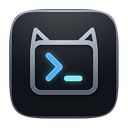

<p align="center">
  
</p>

<h1 align="center">Termewnal</h1>

<p align="center">
  A pure-Rust native terminal emulator and multi-protocol workspace for SSH, resilient tunnels, SFTP+, Serial, Telnet, and containers — inspired by <a href="https://github.com/Eugeny/tabby">Tabby</a>.
</p>

---

## Based on Tabby

> **Termewnal is inspired by and based on the design, workflows, and user experience of [Tabby](https://github.com/Eugeny/tabby) by [Eugeny](https://github.com/Eugeny).**
>
> Special thanks to **[Eugeny](https://github.com/Eugeny)** and all contributors of [`Eugeny/tabby`](https://github.com/Eugeny/tabby) for pioneering an ergonomic terminal & SSH workspace—including its adaptive color-scheme UI system, integrated tab strip, dual-pane SFTP experience, profile manager, quick commands, and community themes. Termewnal reimplements that UX natively in Rust (`iced` + `alacritty_terminal` + `russh`) with zero Electron/WebView overhead, plus built-in Tabby `config.yaml` import support.

---

## Key Features

### Native GPU Workspace & Ergonomics
- **Pure-Rust Desktop Shell**: Single-instance daemon (`iced` with `iced_wgpu`) supporting multiple OS windows coordinated over local IPC, borderless Tabby-style chrome, and configurable tab bar placement (`Top`, `Bottom`, `Left`, `Right`).
- **Tabs & Split Panes**: Arbitrary horizontal/vertical binary split panes, pane zoom, intentional **Broadcast Input** mode, tab pinning/renaming/coloring, Quick Commands, Named Workspaces, and Quake drop-down mode with global hotkey + Linux DBus System Tray (`StatusNotifierItem`).
- **Terminal Engine (`alacritty_terminal` + `portable-pty`)**: Configurable scrollback, in-buffer search (`Ctrl+F`), `OSC 9;4` progress tracking, PTY mouse forwarding, regex highlight rules, session logging, Vietnamese/CJK IME support, clickable HTTP(S) & local `file://` links, and **28 built-in color schemes** (starting with **Tabby Default** dark and **Tabby Default Light**) with custom palette overrides.

### Supervised SSH & Auto-Reconnect
- **Authentication & Forwarding**: Pure-Rust `russh` engine supporting `ed25519`/`rsa`/`ecdsa` keys, OS SSH Agent, passwords, keyboard-interactive 2FA/OTP, multi-hop `ProxyJump`, `ProxyCommand`, Agent Forwarding, X11 Forwarding, and post-connect `LoginScript` automation.
- **Host Verification**: Strict `~/.ssh/known_hosts` checks with interactive SHA-256 Trust On First Use (TOFU) prompts and hard MITM blocks on fingerprint mismatch.
- **Proactive Health & Clear Recovery State**: Active keepalive probes, sleep/wake clock-jump fast-probing, exponential backoff with jitter (`1s..30s`), `tmux`/`screen` auto re-attach, and live **`Auto-reconnecting`** / **`Reconnected successfully`** indicators surfaced in the pane toolbar, Left Sidebar, and Status Bar.

### Resilient Tunnels (`-L`, `-R`, `-D`)
- **Session-Bound & Standalone Tunnels**: Create Local, Remote, and Dynamic SOCKS5 forwards bound to `127.0.0.1` by default (with explicit opt-in prompts for `0.0.0.0`).
- **Seamless Recovery**: Preserves local listeners across transient SSH drops with a 10-second client hold grace window (avoiding `EADDRINUSE`), handles Remote `-R` `RequestDenied` backoff recovery, and displays live **`Auto-reconnecting`** / **`Reconnected successfully`** status in both the Sidebar and Status Bar.

### Non-Blocking SFTP Drawer & SFTP+ Commander
- **Dual Workflows**: Toggleable right-hand SFTP Drawer (`Ctrl+Shift+E`) and Tabby-inspired **SFTP+** dual-pane commander (`Local | Remote`) with drag-and-drop uploads, inline file viewer/editor, bookmarks, sorting, filtering, and permissions editing.
- **Isolated Pipelined Transfers**: Runs bulk uploads/downloads on a dedicated `Transfer Transport` (falling back automatically to multiplexed primary channels on 2FA hosts), writes large files via `.termewnal.part` with atomic rename and byte-offset resume, caps queue concurrency cleanly, and surfaces live **`Auto-reconnecting`** / **`Reconnected successfully`** banners and transfer badges on connection drops.

### Multi-Protocol Connections
- **Serial**: Port discovery, configurable baud/framing/flow control, `Text` / `Readline` / `HexBytes` input modes, `Hexdump` output, and automatic reconnect.
- **Telnet**: Native async TCP Telnet client with IAC/NVT negotiation (`NAWS`, `TTYPE`, `ECHO`, `SGA`) and auto-reconnect.
- **ZMODEM & Containers**: Pure-Rust `rz`/`sz` ZMODEM file transfer engine and Docker/Podman container discovery + shell attachment.

### Safe Configuration, Vault & Migration
- **Atomic TOML Storage**: XDG-compliant configuration (`config.toml`, `profiles.toml`, `quick_commands.toml`, `workspaces.toml`) with schema versioning, `fsync` + atomic rename, 3 rotating `.bak` backups, and safe hot-reload.
- **Isolated `Vault`**: Passwords, key passphrases, and sync tokens never touch TOML files—stored in OS Keyring or an optional Argon2id + AES-256-GCM encrypted `Vault` with idle auto-lock and memory zeroization.
- **OpenSSH & Tabby Import**: Read-only `~/.ssh/config` integration (with 1-click clone to editable Profile), 1-click Tabby `config.yaml` importer, and optional encrypted Config Sync (GitHub Gist, WebDAV, or local directory).

---

## Workspace Architecture

Termewnal is organized as a Cargo workspace separating headless protocol/domain engines from the desktop shell:

```text
termewnal/
├── assets/                   # Embedded app icons (PNG 32..512 & raw 64x64 RGBA)
├── crates/
│   ├── termewnal-core/       # Config schemas, atomic TOML persistence, Vault, OpenSSH/Tabby importers, sync
│   ├── termewnal-pty/        # PTY lifecycle, alacritty_terminal grid, IME, mouse, URL/file links, logging
│   ├── termewnal-protocols/  # Serial terminal, Telnet client, ZMODEM engine, Docker/Podman discovery
│   ├── termewnal-ssh/        # russh supervisor, ProxyJump/ProxyCommand/X11/Agent, resilient tunnels & SFTP
│   └── termewnal-ui/         # iced desktop application, Tabby-inspired UI, SFTP+, Status Bar, Quake/Tray
├── docs/adr/                 # Architecture Decision Records (ADR-0001..0005)
├── DESIGN.md                 # Tabby-aligned visual & UX design system tokens
└── GLOSSARY.md               # Domain terminology
```

For architectural rationale and design tokens, see [DESIGN.md](DESIGN.md), [GLOSSARY.md](GLOSSARY.md), and [`docs/adr/`](docs/adr).

---

## Default Keyboard Shortcuts

| Shortcut | Action |
| --- | --- |
| `Ctrl+K` / `Ctrl+Shift+P` | Open Command Palette |
| `Ctrl+B` | Toggle Left Sidebar (`Profiles` / `Tunnels`) |
| `Ctrl+Shift+E` | Toggle SFTP Drawer / Commander |
| `Ctrl+F` | Search Terminal Scrollback |
| `Ctrl+,` | Open Settings |
| `Ctrl+=` / `Ctrl+-` / `Ctrl+0` | Font Zoom In / Out / Reset |
| `Ctrl+Shift+L` | Clear Terminal |
| `Ctrl+1`..`Ctrl+9` | Switch Workspace Tabs |

*(Shortcuts and multi-key chords can be customized in Settings.)*

---

## Building & Running

Requires Rust **1.91+** (edition `2024`).

```bash
# Run the desktop application
cargo run -p termewnal-ui --bin termewnal

# Build release binary
cargo build --release -p termewnal-ui --bin termewnal

# Build Linux .deb and .tar.gz installers (dist/)
./scripts/build-linux.sh
```

### Verification

```bash
# Type-check all workspace crates and integration tests
cargo check --workspace --all-targets

# Run the full test suite
cargo test --workspace
```

---

## Acknowledgments

- **[Tabby (`Eugeny/tabby`)](https://github.com/Eugeny/tabby)** by **[Eugeny](https://github.com/Eugeny)** — Termewnal is deeply grateful for and directly inspired by Tabby's visual design language, workflow ergonomics, SFTP & tunnel UX concepts, and theme palette ecosystem.
- Built on the Rust ecosystem (`iced`, `alacritty_terminal`, `russh`, `russh-sftp`, `portable-pty`, and `tokio`).
