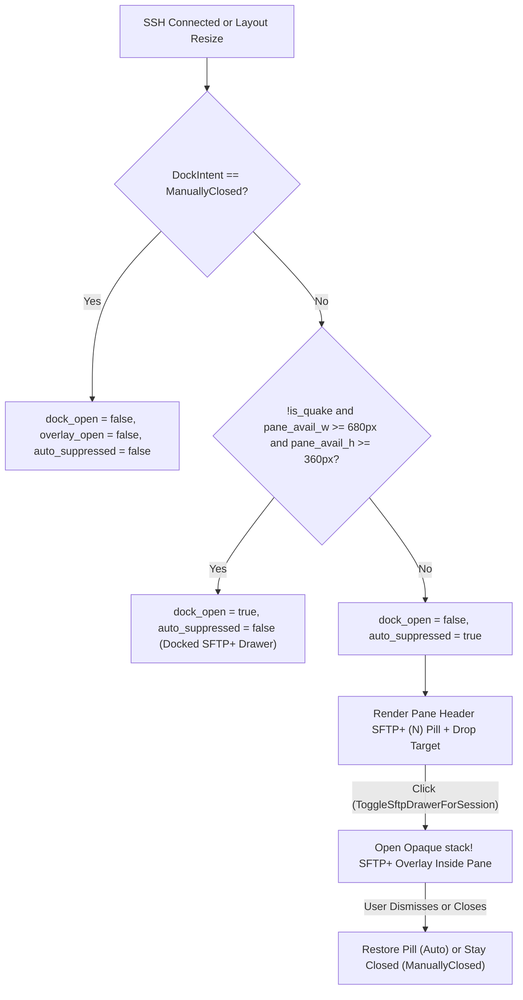

# Adaptive Operational Chrome — UI/UX Redesign for Termewnal

*   **Author:** Moevuive
*   **Status:** Implemented
*   **Date:** 2026-11-27

--------------------------------------------------------------------------------

## Overview

Termewnal is a pure-Rust native terminal emulator and multi-protocol SSH workspace built on `iced 0.14`, `alacritty_terminal`, and `russh` (`termewnal-core`, `termewnal-protocols`, `termewnal-pty`, `termewnal-ssh`, `termewnal-ui`). This design specifies the **Adaptive Operational Chrome** UI/UX redesign across the desktop workspace and Quake drop-down window modes.

The target primary workflow is an SSH and DevOps engineer operating multiple concurrent remote servers, SSH `Tunnel` forwards (`-L`, `-R`, `-D`), and per-`Pane` `SFTP Panel` (`SFTP+`) file browsers alongside an onboarding path (`Start Page`, `~/.ssh/config` import, `Command Palette`, and discoverable navigation chrome) for first-time users. Visual hierarchy, token values, and layout constraints follow a calibrated `iced 0.14` implementation contract backed by the Stitch reference project (`projects/15108367123833185129`) and the static-verified Hallmark prototype (`scratch/hallmark-app/`, `0 FAIL, 0 REFLEX, 0 WARN`).

--------------------------------------------------------------------------------

## The Problem

1.  **Global state locks and cross-window collisions**: `SidebarState::set_open` and `SidebarState::toggle` currently enforce an open lock instead of supporting per-window collapsing across `Compact` (`< 860px`) viewports and `Quake` drop-down windows. Similarly, `SshUiState` prompt queues and `SftpDismissModal` act globally across panes and windows rather than scoping to the originating `Session` or `Pane`.
2.  **Unbounded per-pane `SFTP+` auto-open squeezes split and Quake terminals**: `SftpDrawerState::auto_open_if_allowed` (`auto_open_sftp = true`, `DEFAULT_SFTP_PANEL_WIDTH = 360.0`) opens docked `SFTP+` drawers unconditionally on SSH connect. In multi-pane splits or compact `Quake` windows (`QuakeConfig::size_percent = 45`), docked side drawers reduce terminal columns below readable widths without a non-destructive suppression state distinct from manual user dismissal (`manually_closed`).
3.  **Keybinding, command palette, and documentation drift**: Runtime config defaults (`show_profile_sidebar = true`, `show_status_bar = false`) diverge from `DESIGN.md`. Sidebar toggling lacks an entry in `command_palette.rs` (`workspace_command_items`) and a UI switch in `settings_ui.rs`, while `Ctrl+B` collides with `tmux`/bash line navigation and `Ctrl+Shift+B` is bound to Broadcast Input.
4.  **Flat multiplicative surface hierarchy and inconsistent UI grammar**: `ChromePalette::from_palette` derives surfaces via multiplicative scaling rather than a perceptual lightness ladder across the 28 built-in themes (`BuiltinTheme::ALL`). Additional clutter stems from ALL-CAPS section headers/badges (`ACTIVE SESSIONS`, `GENERAL`/`PORTS`/`ADVANCED`/`LOGIN SCRIPTS`, command palette tags), overloaded footer abbreviations (`"SSH"/"Import"/"Cmds"/"Spaces"/"⚙"`), `Cancel` rendered with `PillTone::Danger` in `profile_ui.rs`, `theme.extended_palette()` fallbacks in pane frames, and inverted `backdrop_dismiss` behavior in `SFTP+`.
5.  **Under-surfaced onboarding and operational context**: First-time users lack a structured empty-workspace `Start Page`, and active SSH/tunnel users need clear visual distinction between active `Session`s, per-`Pane` `SFTP+` file state, tunnel status, and host security prompts (`MitmAlert` / `TOFU`).

--------------------------------------------------------------------------------

## Goals

*   **Geometry-aware per-`Pane` `SFTP+`**: Auto-open docked `SFTP+` on SSH connect only when available pane geometry meets `pane_avail_w >= ~640-700px && pane_avail_h >= 360px && !is_quake`. Suppress automatically into an `auto_suppressed` state (preserving manual intent) in smaller splits and `Quake` windows, exposing a clickable/drop-targeted pane-header `SFTP+ (N)` pill that opens an opaque `stack!` overlay.
*   **Per-window `Sidebar` lifecycle and conflict-free shortcuts**: Support independent per-window `Sidebar` visibility in `WindowState` (default open on desktop `>= 1180px`, auto-collapsed on `< 860px` `Compact` and `Quake` windows), bind `KeyAction::ToggleSidebar` to `Ctrl+Shift+S`, expose it in `Command Palette` and `Settings`, and synchronize `DESIGN.md` with runtime defaults.
*   **Perceptual 4-tier OKLCH `ChromePalette` strictly within `iced 0.14` limits**: Derive all structural surfaces, `1px` hairlines, text ink levels, and semantic accents for all 28 themes using a 4-tier lightness ladder tailored for `iced 0.14` constraints (only `Normal (400)` and `Bold (700)` weights, opaque backgrounds, zero backdrop blur, zero animated drawer widths, sentence-case labels, and zero middle-dot chains).
*   **Pane-scoped security and modal isolation**: Scope `SshUiState` (`TOFU`, auth prompts, `MitmAlert`), `SftpDismissModal`, and disconnected SSH bars to their owning `Session` or `Pane` so concurrent panes never steal focus or cross-dismiss modals.
*   **Unified chrome ergonomics and discoverable onboarding**: Consolidate top chrome around a predictable header (`~40px`), clarify `Sidebar` footer actions and `Start Page` entry points, normalize destructive/neutral button tones (`Cancel` -> neutral), and fix `SFTP+` dismiss/toolbar wrapping ergonomics.

--------------------------------------------------------------------------------

## Non-Goals

*   **Transport and terminal engine rewrites**: No changes to `russh` session cryptography, SFTP wire protocol semantics, `alacritty_terminal` grid parsing, or PTY allocation (`termewnal-pty`, `termewnal-ssh`, `termewnal-protocols` transport logic).
*   **Non-native compositor effects or custom `iced` forks**: No acrylic/Gaussian backdrop blur, CSS-style width slide animations, variable-weight typography (`300`/`500`/`600`), or custom fork patches to `iced 0.14`.
*   **Breaking user `config.toml` preferences**: Existing persisted user overrides (`show_profile_sidebar`, `auto_open_sftp`, `show_status_bar`, custom keybindings) must remain readable via `CURRENT_SCHEMA_VERSION` without destructive resets.
*   **Multi-context domain splits**: Keep the existing root `GLOSSARY.md` and `docs/adr/` layout; do not introduce new workspace crates or alter unrelated CLI tools.

--------------------------------------------------------------------------------

## Open Questions

None. All four architectural questions raised at intake were decided by the author (`Moevuive`) prior to finalizing the Technical Plan below.

--------------------------------------------------------------------------------

## Critical User Journeys (CUJs)

### CUJ 1: First-Launch Onboarding and Workspace Discovery

*   **Given**: A user launches `termewnal` with no open `Session` tabs in a wide desktop window (`>= 1180px`).
*   **When**: The main window renders `render_empty_workspace` alongside the open `Sidebar`.
*   **Then**: The user sees the calibrated `Start Page` offering clear entry actions (connect via existing `Profile`, quick `SSH` target, `~/.ssh/config` import, or `Protocol Launcher`), legible sentence-case `Sidebar` labels and footer controls, and discoverable `Ctrl+Shift+S` / `Command Palette` actions to toggle navigation or inspect `Settings`.

### CUJ 2: Wide-Screen Multi-Server SSH with Auto-Opened `SFTP+` and Tunnels

*   **Given**: A DevOps user operates a desktop window wide enough that the active SSH `Pane` satisfies `pane_avail_w >= ~640-700px && pane_avail_h >= 360px` with `auto_open_sftp = true`.
*   **When**: An SSH `Session` completes connection in that `Pane`, alongside active port forwards (`-L`, `-R`, `-D`).
*   **Then**: The docked `SFTP+` drawer (`SftpDrawerDock`, default `360.0px` clamped within `220..960`) auto-opens for that `Pane` without altering other `Pane`s, tunnel indicators and `Server Stats` remain visible without crowding, and interactive file transfer / `Remote File Editor` workflows run immediately adjacent to the shell.

### CUJ 3: Split-Pane SSH Without Terminal Compression (`auto_suppressed` `SFTP+`)

*   **Given**: A user connects a second SSH `Pane` inside a horizontal/vertical split or resizes the window so `pane_avail_w < ~640-700px` or `pane_avail_h < 360px`.
*   **When**: The SSH `Session` connects or the viewport crosses below the geometry threshold.
*   **Then**: `SFTP+` records `auto_suppressed` (leaving `manually_closed = false`), keeps the terminal grid uncramped, and surfaces a pane-header `SFTP+ (N)` pill showing queued/open file count. Clicking the pill or dragging files over it opens an opaque `stack!` `SFTP+` overlay for that `Pane`; if the user later closes the split or maximizes the window (without having manually closed `SFTP+`), docked `SFTP+` restores automatically.

### CUJ 4: Quake Drop-Down Mode Instant Operational Triage

*   **Given**: The user invokes the `Quake` top drop-down window (`QuakeConfig`, `size_percent = 45`).
*   **When**: The `Quake` window opens or connects to a remote SSH `Profile`.
*   **Then**: The `Quake` window automatically collapses its `Sidebar` per-window and suppresses docked `SFTP+` in favor of the pane-header `SFTP+ (N)` pill overlay, preserving desktop window `Sidebar` visibility and desktop `SFTP+` layout preferences.

### CUJ 5: Pane-Scoped SSH Security Prompts (`MitmAlert`, `TOFU`, Auth)

*   **Given**: The user runs multiple concurrent SSH `Pane`s across separate tabs or splits.
*   **When**: Pane A triggers a `TOFU` host-key verification modal, password/OTP prompt, `MitmAlert` host-key mismatch warning, or unexpected disconnect while Pane B is active.
*   **Then**: Only Pane A renders the scoped security/auth/reconnect chrome (and blocks remote I/O on `MitmAlert` until resolved), Pane B's terminal input remains uninterrupted, and dismissing an `SFTP+` modal in one `Pane` never closes prompts in another `Pane`.

### CUJ 6: Conflict-Free Keyboard and Settings Control

*   **Given**: A user is inside an interactive remote `tmux`/bash shell where `Ctrl+B` is bound to shell/tmux prefix commands.
*   **When**: The user presses `Ctrl+B`, or invokes `Ctrl+Shift+S`, or opens `Command Palette` / `Settings` (`Appearance` / `Navigation`).
*   **Then**: `Ctrl+B` passes directly to the PTY/SSH stream, `Ctrl+Shift+B` remains reserved for Broadcast Input, and `Ctrl+Shift+S` (alongside matching entries in `Command Palette` and `Settings`) toggles only the focused window's `Sidebar`.

--------------------------------------------------------------------------------

## Technical Plan (Architecture)

The redesign establishes five coordinated architectural changes anchored on four design decisions selected by the author (`Moevuive`):

1.  **State Ownership (Option A)**: Store per-window `Sidebar` visibility override directly on `WindowState` (`sidebar_override: Option<bool>`) alongside unlocking `SidebarState`, and extend `SftpDrawerState` with `auto_suppressed: bool` constrained by transition invariants.
2.  **Unified Top Header (Option A)**: Retain the full-width top header (`~40px`) above `SidebarDock` and `Workspace`, keeping separate render builders (`render_tab_strip` when `Top`, `render_top_system_title_bar` otherwise) with `TitleBarDragZone` scoping `middle_spacer`, and widen the top-right button exclusion zone in `BorderlessResizeFrame::edge_direction`.
3.  **OKLCH Palette Boundary (Option A)**: Replace multiplicative HSL stepping in `ChromePalette::from_palette` with a 4-tier OKLCH lightness ladder, migrate `PaneFrame::draw` and `draw_interactive_divider` off `theme.extended_palette()` + hardcoded RGB values onto `ChromePalette` tokens, and keep `AppState::theme(win)` returning standard `iced::Theme` variants for built-in themes.
4.  **Scoped SSH Alerts & File Modals (Option A)**: Retain queues on `SshUiState` while routing rendering and terminal keyboard/IME suppression per `SessionId` inside `render_pane`, persist a non-dismissible `mitm_blocked: bool` guard on `SshSessionSlot`, and parameterize `Message::SftpDismissModal(Option<SessionId>)`.

### System Topology Overview

```text
+-----------------------------------------------------------------------------------+
| Full-Width Top Header (40px) [TitleBarDragZone on spacer]            [-][o][x]  |
| (Sidebar Toggle | Session Tabs | + New Tab | Quake | Settings | Window)     |
+------------------+----------------------------------------------------------------+
| SidebarDock      | Workspace Body (SplitNode Tree)                                |
| (~250px,         |  +-------------------------+--------------------------------+  |
| per-window via   |  | Pane A [SSH]  SFTP+ (2) | Pane B [SSH]                   |  |
| sidebar_override)|  | (pane_w >= 680 & h >= 360 | (split or Quake < threshold:   |  |
|                  |  |  -> Docked SFTP+ Drawer   |  -> auto_suppressed = true,    |  |
| - Search/Filter  |  |  adjacent to terminal;    |  pane-header SFTP+ (N) pill    |  |
| - Active Sessions|  |  scoped Auth/TOFU/MITM)   |  opens opaque stack! overlay)  |  |
| - Profiles/Import|  +-------------------------+--------------------------------+  |
| - Active Tunnels |                                                                |
| - Footer Bar     |  Or empty tab -> Onboarding Start Page (Quick SSH, Import,    |
|   SSH|Import|... |  Protocol Launcher, Ctrl+Shift+S / Ctrl+K shortcut hints)      |
+------------------+----------------------------------------------------------------+
```

### Subsystem 1: Per-Window `Sidebar` Lifecycle and Shortcuts

*   **Per-window visibility state (`app.rs`, `sidebar.rs`)**:
    *   Unlock `SidebarState::set_open` and `SidebarState::toggle` so user toggles change state instead of remaining pinned open. Keep filter/group/section expansion shared on `AppState::sidebar: SidebarState`.
    *   Extend `WindowState` (`width`, `height`, `maximized`, `workspace`) with `sidebar_override: Option<bool>`.
    *   Initialize `Quake` windows (`AppState::toggle_quake_window`) with `sidebar_override: Some(false)` so drop-down windows open straight into terminal focus without modifying desktop window preferences.
    *   Add `AppState::effective_sidebar_open(&self, window_id: window::Id) -> bool`:
        *   If `WindowState::sidebar_override` is `Some(pin)`, return `pin`.
        *   Else if `self.quake.window_id() == Some(window_id)` or `ViewportTier::from_width(window.width as f32)` is `Compact` (`< 860px`), return `false`.
        *   Else return `self.config.terminal.show_profile_sidebar`.
    *   Route `Message::ToggleSidebar` and `Message::SetSidebarOpen(open)` to update `sidebar_override` for `self.active_window` (`Some(!current)` or `Some(open)`), leaving sibling windows untouched.
*   **Keybindings, Command Palette, Settings, and Docs (`keybindings.rs`, `keybinding_bridge.rs`, `command_palette.rs`, `settings_ui.rs`, `DESIGN.md`)**:
    *   Add `KeyAction::ToggleSidebar` to `KeyAction::ALL` (46 -> 47 actions) with `default_bindings` returning `vec!["Ctrl+Shift+S"]`. `Ctrl+B` stays unintercepted for `bash`/`tmux`, and `Ctrl+Shift+B` remains reserved for `KeyAction::ToggleBroadcastInput`.
    *   Map `KeyAction::ToggleSidebar => Some(Message::ToggleSidebar)` in `keybinding_bridge::action_to_message`.
    *   Include `PaletteAction::ToggleSidebar` in `command_palette::workspace_command_items` with shortcut hint `"Ctrl+Shift+S"`.
    *   Expose a `"Show Profiles sidebar by default"` toggle in `settings_ui.rs` (`SettingsShowProfileSidebarToggled` already exists in `app.rs` -> wired into `SettingsTab::Appearance`) and update `DESIGN.md`, `README.md`, and `crates/termewnal-core/src/README.md` to reflect runtime defaults (`show_profile_sidebar = true`, `Ctrl+Shift+S`, unified header behavior).
    *   Update `KeybindingConfig::resolver` (`keybindings.rs`) to evaluate user-overridden bindings before built-in defaults (`[true, false]` two-pass insertion).
*   **Sidebar chrome cleanup (`sidebar.rs`)**:
    *   Replace ALL-CAPS labels (`"ACTIVE SESSIONS"`, etc.) with sentence-case headings (`"Active sessions"`, `"Profiles"`, `"Active tunnels"`, `"Imported from ~/.ssh/config"`).
    *   Declutter the footer strip into clear, scannable action targets (`SSH`, `Import`, `Commands`, `Templates`, `Settings`) with consistent button sizing, hairline separation, and a `"Hide sidebar"` row displaying the `Ctrl+Shift+S` keycap pill.

### Subsystem 2: Geometry-Aware Per-`Pane` `SFTP+` and Overlay Fallback



*   **Geometry computation (`workspace.rs`, `split_view.rs`, `app.rs`)**:
    *   Add `SPLIT_DIVIDER_THICKNESS`, `split_first_size`, and a pure recursive rectangle pass `SplitNode::collect_pane_bounds(available: Rectangle)` in `workspace.rs` (reused by `split_view.rs`) so `AppState` determines exact available dimensions per `PaneId`.
    *   For a window's workspace body (`available_w = window.width - active_sidebar_w`, `available_h = window.height - header_h - optional_status_bar_h`), determine `is_eligible = !is_quake && pane_size.width >= 680.0 && pane_size.height >= 360.0` (with auto-open gated on `config.terminal.auto_open_sftp`). The `680.0px` threshold retains at least `320.0px` for the terminal alongside `DEFAULT_SFTP_PANEL_WIDTH` (`360.0px`).
*   **Drawer state invariants (`sftp_drawer.rs`, `sftp_plus.rs`)**:
    *   Model explicit drawer intent on `SftpDrawerState` using private `DockIntent { Auto, DockedOpen, ManuallyClosed }` alongside `dock_open`, `overlay_open`, and `auto_suppressed` (retaining `open` / `manually_closed` accessors via `is_open()`, `is_docked_open()`, `is_overlay_open()`, `is_auto_suppressed()`, `is_manually_closed()`):
        *   `auto_open_for_geometry(&mut self, geometry_eligible: bool) -> bool`: returns `false` if `ManuallyClosed`. Sets `dock_open = true, overlay_open = false, auto_suppressed = false` when `geometry_eligible`, or `dock_open = false, auto_suppressed = true` when ineligible.
        *   `reconcile_geometry(&mut self, geometry_eligible: bool)`: leaves `ManuallyClosed` untouched; collapses `DockedOpen` or `Auto` into `dock_open = false, auto_suppressed = true` without popping overlays unexpectedly on shrink (while keeping already-open overlays alive), and restores `dock_open = true, overlay_open = false, auto_suppressed = false` when geometry becomes eligible again.
        *   `set_open_with_eligibility(&mut self, open: bool, geometry_eligible: bool)` (and `set_open(open)`): opens docked when `geometry_eligible` or `overlay_open` when `!geometry_eligible`, preserving `DockIntent::Auto` when closing an auto-suppressed overlay so expanding the pane still auto-restores. Also lower `SftpDrawerDock::clamped_panel_width` minimum clamp when total width `< MIN_SFTP_DRAWER_WIDTH` so narrow bounds never overflow horizontally.
    *   When rendered inside a pane where `drawer.is_overlay_open()`, render `SFTP+` inside an opaque `iced::widget::opaque` `stack!` overlay (`chrome.panel_bg`, `1px` `chrome.hairline`) covering the pane body rather than shrinking terminal grid columns horizontally, reusing `Message::ToggleSftpDrawerForSession(SessionId)` without adding redundant overlay-only messages.
    *   Fix `file_viewer_backdrop_dismiss(session_id, editable, dirty)` (`sftp_plus.rs`), add wrap-friendly toolbar rows for narrow drawers (`<= 380px`), and keep pane-local file drops functional on open panels and Shift-dropped targets (coordinate-less hover overlay triggers were intentionally omitted to avoid spurious popups).

### Subsystem 3: Full-Width Top Header (`~40px`) and Start Page Onboarding

*   **Header geometry and hit-testing (`window_chrome.rs`, `ui_theme.rs`, `app.rs`)**:
    *   Raise `TAB_BAR_HEIGHT` (`ui_theme.rs`) from `38.0px` to `40.0px` to give tab text, `Sidebar` toggle affordance, and top-right controls balanced vertical padding.
    *   Preserve the full-width top header band (`render_tab_strip` for `TabBarPosition::Top`, `render_top_system_title_bar` for `Bottom`/`Left`/`Right`) reserving `>= 72px` for a center drag spacer when `strip_width` permits and wrapping spacer regions in `TitleBarDragZone::with_resize_guard(..., EDGE_RESIZE_HIT_PX, ...)`.
    *   Evaluate children before frame resize/drag handling inside `BorderlessResizeFrame` and `TitleBarDragZone` (`resolve_resize_press` / `allows_drag_at`, removing the legacy `190.0` top-right magic exclusion constant) so right-hand operational pills and window controls remain clickable right up to the top edge while the top `5px` spacer triggers resize.
*   **Onboarding Start Page (`app.rs` `render_empty_workspace`)**:
    *   Align empty-workspace layout with the calibrated Hallmark / Stitch Start Page (`scratch/hallmark-app/index.html`, Stitch screen `155f455fe3b748efb3415770f8f422a9`):
        *   Clear primary actions: `"New SSH connection"` (`OpenQuickConnectPalette`), `"Import ~/.ssh/config"` (`SidebarImport`), and direct protocol chips (`Local Shell`, `SSH`, `Serial`, `Telnet`, `Docker`).
        *   Compact keyboard legend showing verified shortcuts (`Ctrl+Shift+S` Sidebar, `Ctrl+K` Command Palette, `Ctrl+Shift+D` Split Vertical, `Ctrl+Shift+E` SFTP+).

### Subsystem 4: 4-Tier Perceptual OKLCH `ChromePalette` and `iced 0.14` Surface Grammar

*   **Perceptual lightness ladder (`ui_theme.rs`, `termewnal-core/src/theme.rs`)**:
    *   Implement pure-Rust `srgb_to_oklch` / `oklch_to_srgb` helpers inside `ui_theme.rs` (zero external crate dependency required) and replace multiplicative `hsl_lighten`/`hsl_darken` scaling in `ChromePalette::from_palette` for all 28 `BuiltinTheme::ALL` schemes + `ThemeOverrides`.
    *   Derive ordered opaque surface tiers anchored on `ThemePalette::background` (`L_base`, with ultra-dark clamp `anchor = max(L_base + 0.045, 0.150)` when `L_base < 0.165`):

| Chrome Token Tier | UI Role | Dark Theme Target (OKLCH vs `L_base`) | Light Theme Target (OKLCH vs `L_base`) | Verified Contract Target |
| :--- | :--- | :--- | :--- | :--- |
| **Surface 0** (`bg_more`, `chrome_bg`) | Top header, `SidebarDock`, inset chrome | `L_base - 0.050` / `-0.034` (`>= 0.110` / `0.125`) | `L_base - 0.060` / `-0.044` | `--color-paper-2` |
| **Terminal Canvas** (`term_bg`) | Terminal viewport grid (`alacritty_terminal`) | `L_base` | `L_base` | `--color-paper` |
| **Input Well** (`input_bg`) | Recessed input fields | `L_base - 0.018` (`>= 0.105`) | `L_base + 0.012` (`<= 1.0`) | Inset input well |
| **Elevated Surfaces** (`well_bg` / `bg_less`, `panel_bg`, `card_bg` / `secondary`) | Inset wells, `SFTP+` overlays/dialogs, active tabs & controls | `+0.028` / `+0.050` / `+0.078` | `-0.026` / `+0.022` / `-0.086` | `--color-overlay` / `--color-paper-3` |
| **Hairlines** (`hairline`, `border_subtle`, `border`) | `1px` borders, dividers, pane frames | `+0.075` / `+0.120` / `+0.200` off `panel` | `-0.085` / `-0.135` / `-0.220` off `chrome` | `--color-rule` / `--color-rule-2` |

*   **`PaneFrame` & divider migration (`split_view.rs`, `ui_theme.rs`)**:
    *   Pass `ChromePalette` tokens into `PaneFrame` and `draw_interactive_divider` so split dividers, unfocused borders, focused borders (`chrome.accent`), and Broadcast Input borders (`chrome.danger`) read directly from OKLCH `ChromePalette` rather than `theme.extended_palette()` or hardcoded `Color::from_rgb8(220, 38, 38)`.
    *   Retain `AppState::theme(win)` returning built-in `iced::Theme` variants (`Theme::Light`, `Theme::TokyoNight`, etc.) to preserve existing `Theme` identity behavior for standard `iced` widgets and integration assertions.
*   **Strict `iced 0.14` Calibration Contract enforcement across screens**:
    *   Weights: `Weight::Normal` (`400`) and `Weight::Bold` (`700`) only.
    *   Surfaces: opaque `a = 1.0` backgrounds for `SidebarDock`, `SFTP+` overlays, menus, and modal cards (scrim overlays remain semi-transparent backdrop dimmers without blur).
    *   Copy hygiene: remove ALL-CAPS section tabs/badges (`GENERAL`/`PORTS`/`ADVANCED`/`LOGIN SCRIPTS` -> `General`/`Ports`/`Advanced`/`Login scripts` in `profile_ui.rs`, badge normalization in `command_palette.rs` and `v2_modals.rs`), eliminate middle-dot (`·`) text chains in status summaries and tunnel cards (`tunnel_ui.rs`, `status_bar.rs`, `server_stats_bar.rs`), and fix `profile_ui.rs:1343` `Cancel` button from `PillTone::Danger` to neutral secondary styling.
    *   Reference mapping to Stitch project `15108367123833185129` (`assets/8369308359466938333`) and `scratch/hallmark-app/`: Screen `06915c16ab64486e8b9e5f19c0d4fd26` -> Wide SSH + docked `SFTP+`; Screen `e66dda7fa21d43b597411fc47128d40b` -> 2-Pane Split with suppressed `SFTP+ (N)` header pills; Screen `4697ba9ef12b41d2824af130ca6b8e91` -> `Quake` collapsed chrome; Screen `155f455fe3b748efb3415770f8f422a9` -> Empty workspace `Start Page`.

### Subsystem 5: Pane-Scoped SSH Security Prompts and `SftpDismissModal` Isolation

*   **Per-`Session` rendering and input gating (`ssh_ui.rs`, `app.rs`)**:
    *   Keep `host_key_queue`, `auth_queue`, and `mitm_alerts` on `AppState::ssh_ui`, and add lookup/render helpers keyed by `SessionId`: `host_key_prompt_for_session(session_id)`, `auth_prompt_for_session(session_id)`, `session_has_blocking_prompt(session_id)`, `auth_prompt_input_id`, `view_mitm_alert_for_session`, scrollable pane-clamped `view_tofu_modal_for_session`, and scrollable `view_auth_prompt_for_session`.
    *   Move SSH prompt rendering from `AppState::view` top-level `content_col` into `render_pane` so prompts overlay only the originating `Pane` while concurrent `Pane`s and windows remain interactive.
    *   Scope modal focus gating per window via `AppState::has_modal_open_in_window(window_id)` (checking app modals plus active-tab `sftp_drawers` modals/context menus) alongside `session_has_blocking_prompt(session_id)`, track native OS file/folder pickers via `in_flight_os_dialogs: usize` (`begin_os_dialog` / `end_os_dialog`) so Quake `hide_on_blur` ignores OS dialog focus shifts, and purge pending `SshUiState` entries for closed sessions in `AppState::remove_session`.
*   **Persistent `mitm_blocked` invariant (`app.rs` `SshSessionSlot`)**:
    *   Add `mitm_blocked: bool` (initialized `false`, read via `is_mitm_blocked()`) directly on `SshSessionSlot`.
    *   Set `slot.mitm_blocked = true` alongside `ssh_ui.record_mitm_alert(alert)`.
    *   `Message::DismissMitmAlert(session_id)` removes only the visual alert card from `ssh_ui.mitm_alerts` and keeps `slot.mitm_blocked == true`.
    *   Gate `reconnect_ssh_session`, `probe_and_reconnect_all`, `view_disconnected_ssh_bar`, and Enter-to-reconnect on `!slot.mitm_blocked && self.ssh_ui.mitm_alert(session_id).is_none()` so dismissing the banner never re-enables reconnection against a changed host key.
*   **Scoped `SFTP+` modal dismissal (`app.rs`, `sftp_plus.rs`)**:
    *   Parameterize both `Message::SftpDismissModal(Option<SessionId>)` and `Message::SftpModalRequestClose(Option<SessionId>)`, wiring modal backdrops/close buttons in `sftp_plus.rs` (`build_modal_shell_for_session` / `file_viewer_backdrop_dismiss`) with `state.bound_session_id()`.
    *   Update `AppState::update` so `SftpDismissModal(Some(sid))` / `SftpModalRequestClose(Some(sid))` act only on `sftp_drawers.get_mut(&sid)` and `None` resolves only `self.sftp_session_for_modal()` instead of iterating `self.sftp_drawers.values_mut()`, while keeping `sftp_modal_drawer` and `sftp_context_menu_drawer` scoped to each window's workspace.

--------------------------------------------------------------------------------

## Alternatives Considered

### Alternative A: Web-Faithful Stitch Effects (Backdrop Blur, Width Transitions, 500/600 Font Weights)

*   **Pros**: Visual chrome mirrors raw Google Stitch HTML output with translucent glass drawers, CSS-like animated width slides, intermediate UI font weights, and condensed middle-dot (`·`) inline metadata chains.
*   **Cons**: Violates native `iced 0.14` widget/renderer constraints (`Normal (400)` and `Bold (700)` weights only), introduces unstable alpha blending seams over sub-pixel terminal glyph grids, and triggers expensive per-frame terminal PTY column reflows during drawer width interpolation.
*   **Reason for Rejection**: Rejected by author: native `iced 0.14` stability, predictable column widths, and readability take precedence over translucent web effects; all Stitch concepts were recalibrated against `scratch/hallmark-app/` (`sloplint` `0 FAIL, 0 REFLEX, 0 WARN`).

### Alternative B: Fixed Single Dark Theme Replacing the 28 Built-In Color Schemes

*   **Pros**: Simplifies palette maintenance to one tuned dark contrast table (`tokens.css` default dark values) with zero algorithmic color math.
*   **Cons**: Discards existing `BuiltinTheme::ALL` (28 themes) and user `ThemeOverrides` support in `termewnal-core/src/theme.rs`, breaking user appearance customization and light-mode environments.
*   **Reason for Rejection**: Rejected by author: preserving all 28 built-in themes and `ThemeOverrides` while upgrading `ChromePalette::from_palette` to a perceptual 4-tier OKLCH lightness ladder delivers consistent hierarchy without sacrificing theme identity.

### Alternative C: Unconditional Per-Pane Docked `SFTP+` or Global Manual-Only Drawer

*   **Pros**: Unconditional `auto_open_if_allowed` guarantees docked file access immediately on every SSH pane; conversely, a global manual-only drawer guarantees terminal space is never compressed.
*   **Cons**: Unconditional auto-open shrinks narrow split panes and `Quake` top drop-down viewports (`size_percent = 45`) into unreadable column widths, whereas disabling auto-open on wide panes forces repetitive manual toggles for DevOps side-by-side SSH and SFTP workflows.
*   **Reason for Rejection**: Rejected by author: geometry-gated auto-open (`!is_quake && pane_avail_w >= 680.0 && pane_avail_h >= 360.0`) with non-destructive `auto_suppressed` state plus the pane-header `SFTP+ (N)` overlay satisfies both wide multi-pane workflows and compact/Quake constraints.

### Alternative D: Keep `Sidebar` Permanently Open or Rebind `Ctrl+B`

*   **Pros**: Retaining the `SidebarState::set_open` lock prevents accidental hiding of connection lists; binding `Ctrl+B` matches legacy `DESIGN.md` text and web conventions.
*   **Cons**: `Ctrl+B` intercepts `tmux` prefix and bash backward-char navigation, `Ctrl+Shift+B` already binds Broadcast Input, and permanently open sidebars waste horizontal terminal width in `Compact` (`< 860px`) and `Quake` windows.
*   **Reason for Rejection**: Rejected by author: unlocking per-window `Sidebar` visibility (`WindowState::sidebar_override`) and binding `Ctrl+Shift+S` (plus `Command Palette` and `Settings`) resolves shell conflicts and compact-viewport clipping.

### Alternative E: Public `SftpDockIntent` / Centralized `WorkspaceLayoutRegistry` vs Private `DockIntent` State Machine

*   **Pros**: Exporting disjoint state enums globally or centralizing layout coordination inside a dedicated `WorkspaceLayoutRegistry` externalizes window/pane layout tracking.
*   **Cons**: Requires wide signature churn across external consumers and existing integration test suites (`navigation_chrome`, `sftp_drawer_and_transfers`) that query `SidebarState::is_open()` or `SftpDrawerState` directly.
*   **Decision Taken**: Kept `WindowState::sidebar_override: Option<bool>` in `AppState` and introduced a private `DockIntent { Auto, DockedOpen, ManuallyClosed }` enum paired with `dock_open`, `overlay_open`, and `auto_suppressed` accessors (`is_docked_open`, `is_overlay_open`, `is_auto_suppressed`, `set_open_with_eligibility`) on `SftpDrawerState`, preserving existing test compatibility while eliminating invalid boolean combinations internally.

### Alternative F: Column-Split Top Header or Child-First `BorderlessResizeFrame`

*   **Pros**: Splitting the header vertically along the `Sidebar` divider mirrors Stitch's two-column silhouette; conversely, evaluating children before the outer frame eliminates brittle magic exclusion pixel constants along the top border.
*   **Cons**: Column-splitting divides window drag zones and demands seam alignment during `Sidebar` toggles.
*   **Decision Taken**: Preserved the full-width top header (`40px`) across `render_tab_strip` / `render_top_system_title_bar` with `max_tabs_w` reserving `>= 72px` for `TitleBarDragZone::with_resize_guard`, and switched `BorderlessResizeFrame` / `TitleBarDragZone` (`resolve_resize_press`, `allows_drag_at`) to child-first hit/cursor evaluation without any `190.0` hardcoded exclusion constant.

### Alternative G: Regenerate `iced::Theme::custom_with_fn` Across All 28 Built-In Themes

*   **Pros**: Synchronizes `PaneFrame`, split dividers, and default `iced` widgets (`scrollable`, `text_input`, `pick_list`) through a single `extended_palette()` source without passing `ChromePalette` into low-level widgets.
*   **Cons**: Replaces built-in `iced::Theme` variants (`Theme::Light`, `Theme::TokyoNight`) on `AppState::theme(win)`, failing existing enum equality assertions in `tabby_ui_ux.rs`, while `iced::theme::Palette` only exposes coarse base slots rather than an exact 4-tier OKLCH surface ladder.
*   **Reason for Rejection**: Rejected by author: migrating `PaneFrame::draw` and `draw_interactive_divider` directly onto OKLCH `ChromePalette` while keeping built-in `iced::Theme` variants fixes split frame and divider mismatches without churning `AppState::theme(win)`.

### Alternative H: Migrate `SshUiState` Queues Into `SshSessionSlot` or Keep Window-Global `MitmAlert`/`TOFU` Modals

*   **Pros**: Storing `pending_host_key`, `pending_auth`, and `mitm_alert` directly on `SshSessionSlot` gives 1-to-1 RAII drop cleanup per session; alternatively, rendering `TOFU`/`MitmAlert` at the window level guarantees prominent readability on tiny splits.
*   **Cons**: Moving responder channels and queues off `SshUiState` touches `UiSshInteractionHandler` and SSH test harnesses extensively, while window-level `TOFU`/`MitmAlert` overlays still interrupt foreground typing when triggered by a background pane in the same window.
*   **Reason for Rejection**: Rejected by author: scoping `SshUiState` query/render helpers by `SessionId` directly inside `render_pane`, adding a persistent `mitm_blocked: bool` field on `SshSessionSlot`, and parameterizing `Message::SftpDismissModal(Option<SessionId>)` isolates concurrent panes with minimal disruption.

--------------------------------------------------------------------------------

## Non-Functional Requirements

*   **Security & Privacy**:
    *   **Fail-closed host-key verification**: `SshSessionSlot::mitm_blocked` must enforce a permanent per-slot reconnect block on MITM detection regardless of UI banner dismissal (`Message::DismissMitmAlert`).
    *   **Secret hygiene**: Retain `Zeroizing<String>` wiping in `PendingAuthState::drop` (`ssh_ui.rs`) and `Vault` session controls without duplicating secret buffers into UI chrome snapshots.
    *   **Explicit public-bind confirmation**: Keep `TunnelUiState` public-bind warning modal (`0.0.0.0` / `::`) intact with neutral Cancel and emphasized Confirm actions.
*   **Performance & Frame Latency**:
    *   **Bounded palette math**: Compute OKLCH `ChromePalette` conversions strictly using constant-time floating-point color math (`srgb -> oklab -> oklch -> srgb`), caching or computing per theme change rather than per terminal cell redraw.
    *   **`iced 0.14` redraw discipline**: Zero translucent backdrop blur layers and zero animated drawer width transitions so terminal PTY/SSH frame pacing remains flat during split resizing and rapid output.
    *   **O(N_panes) geometry check**: `SplitNode::collect_pane_bounds` traverses only the active tab's binary split tree on window resize, split creation/closure, or SSH connect.
*   **Backward Compatibility & Rollout**:
    *   Preserve `CURRENT_SCHEMA_VERSION = 1` in `termewnal-core/src/config.rs`; existing `config.toml` and `layout.toml` files deserialize without migration failures.
    *   Users without a manual `ToggleSidebar` override in `config.toml` automatically receive `Ctrl+Shift+S`; explicit user overrides remain honored.

--------------------------------------------------------------------------------

### Additional Resources

*   **Finalized Brainstorm Brief & RFC**: `docs/designs/adaptive-operational-chrome-ui-ux.md` (and `concepts_brief.md`)
*   **Project Repository Documentation**: `README.md`, `GLOSSARY.md`, `DESIGN.md`, `crates/termewnal-ui/src/README.md`, `crates/termewnal-core/src/README.md`
*   **Google Stitch Design Project**: `projects/15108367123833185129` (`assets/8369308359466938333`), screens `06915c16ab64486e8b9e5f19c0d4fd26` (Wide SSH + SFTP+), `e66dda7fa21d43b597411fc47128d40b` (2-Pane Split SSH), `4697ba9ef12b41d2824af130ca6b8e91` (Quake Drop-Down), and `155f455fe3b748efb3415770f8f422a9` (Onboarding Start Page)
*   **Calibrated Hallmark Reference**: `/home/moe_mint/.gemini/antigravity/brain/01ef2fba-1882-4c3b-8079-09951eaaa450/scratch/hallmark-app/` (`tokens.css`, `base.css`, `app.css`, `index.html`; `sloplint` verified: `0 FAIL, 0 REFLEX, 0 WARN`)

### Future Improvements

*   **User-configurable `SFTP+` auto-open pixel thresholds**: Expose the `680.0px x 360.0px` pane eligibility threshold in `TerminalConfig` if ultra-wide / high-DPI power users ask to tune docked drawer triggers beyond defaults.
*   **Unified header builder consolidation**: Consolidate `render_tab_strip` (`Top`) and `render_top_system_title_bar` (`Bottom`/`Left`/`Right`) once `Top` tab placement stabilization lands across desktop and `Quake` test coverage.

--------------------------------------------------------------------------------

## Detailed Implementation Plan

### Target Files to Create/Modify

#### 1. `crates/termewnal-core/src/keybindings.rs` (Modify)

*   **Type / Scope**: Core keybinding registry and default chord mapping.
*   **Proposed Changes**:
    *   Include `KeyAction::ToggleSidebar` in `KeyAction::ALL` (`46 -> 47` actions) so `KeybindingConfig::resolver` registers the default binding and surfaces it in Settings keybinding rows.
    *   Update `KeyAction::default_bindings` so `Self::ToggleSidebar` returns `vec!["Ctrl+Shift+S"]`. Retain empty collisions against `Ctrl+B` (`bash`/`tmux` pass-through) and `Ctrl+Shift+B` (`KeyAction::ToggleBroadcastInput`).

#### 2. `crates/termewnal-ui/src/keybinding_bridge.rs` (Modify)

*   **Type / Scope**: Keybinding-to-Elm message bridge.
*   **Proposed Changes**:
    *   Map `KeyAction::ToggleSidebar => Some(Message::ToggleSidebar)` inside `action_to_message` instead of returning `None`.

#### 3. `crates/termewnal-ui/src/ui_theme.rs` (Modify)

*   **Type / Scope**: `iced 0.14` color tokens, typography helpers, and border/divider drawing primitives.
*   **Proposed Changes**:
    *   Implement deterministic sRGB <-> Oklab <-> OKLCH color math functions and rewrite `ChromePalette::from_palette` to compute the 4-tier lightness ladder (`bg_more`/`chrome_bg`, `term_bg`, `panel_bg`/`card_bg`/`well_bg`, `secondary`/`input_bg`) plus `1px` `hairline`/`border` and WCAG-guarded foreground ink tokens across all 28 `BuiltinTheme::ALL` schemes and `ThemeOverrides`.
    *   Align `ui_font_medium()` / `ui_font_semibold()` font helpers strictly to `iced::font::Weight::Normal` (`400`) and `iced::font::Weight::Bold` (`700`).
    *   Raise `TAB_BAR_HEIGHT` from `38.0` to `40.0`.
    *   Update `draw_interactive_divider` to consume `ChromePalette` (`accent`, `hairline`) instead of reading `theme.extended_palette()`, and update docstrings referencing legacy ALL-CAPS tab labels.

#### 4. `crates/termewnal-ui/src/window_chrome.rs` (Modify)

*   **Type / Scope**: Borderless window frame hit-testing and system bar helpers.
*   **Implemented Changes**:
    *   Replaced the legacy `190.0` top-right exclusion magic constant by evaluating child widgets first in `BorderlessResizeFrame` (`resolve_resize_press`) and `TitleBarDragZone::with_resize_guard` (`allows_drag_at`, gating drag below `top_resize_guard_px`), keeping right-hand operational pills and caption buttons clickable right up to the top `5.0px` edge.
    *   Verified `render_top_system_title_bar` matches `40.0px` header height (`TAB_BAR_HEIGHT`) and `TitleBarDragZone` wraps spacer content.

#### 5. `crates/termewnal-ui/src/sidebar.rs` (Modify)

*   **Type / Scope**: Navigation sidebar component and profile/tunnel tree state.
*   **Implemented Changes**:
    *   Unlocked `SidebarState::set_open` and `SidebarState::toggle` so `SidebarState` tracks an actual `bool` state alongside per-window `WindowState::sidebar_override` arbitration.
    *   Changed `SidebarDock` section headings (`"ACTIVE SESSIONS"` -> `"Active sessions"`, `"IMPORTED FROM ~/.ssh/config"` -> sentence case) and replaced middle-dot concatenations (`"No saved profiles..."`, `"via"` host summaries) with spaced typography rows.
    *   Reorganized bottom footer controls (`"SSH"/"Import"/"Cmds"/"Spaces"/⚙`) into legible sentence-case buttons (`SSH`, `Import`, `Commands`, `Templates`, `Settings`) plus a `"Hide sidebar"` control displaying `Ctrl+Shift+S`.

#### 6. `crates/termewnal-ui/src/sftp_drawer.rs` (Modify)

*   **Type / Scope**: Per-session/per-pane `SFTP+` visibility and drawer state model.
*   **Implemented Changes**:
    *   Replaced overloaded boolean flags with internal `DockIntent` (`Auto`, `DockedOpen`, `ManuallyClosed`), `dock_open`, `overlay_open`, and `auto_suppressed`, adding `is_docked_open`, `is_overlay_open`, `is_auto_suppressed`, `set_open_with_eligibility`, `auto_open_for_geometry`, and `reconcile_geometry`.
    *   Updated `SftpDrawerDock::clamped_panel_width` (`MIN_SFTP_DRAWER_WIDTH.min(max_allowed)`) so narrow pane widths never overflow horizontally.

#### 7. `crates/termewnal-ui/src/workspace.rs` & `split_view.rs` (Modify)

*   **Type / Scope**: Binary split container layout computation and pane border widget (`PaneFrame`).
*   **Implemented Changes**:
    *   Added `SPLIT_DIVIDER_THICKNESS`, `split_first_size`, and recursive `SplitNode::collect_pane_bounds` in `workspace.rs` (reused by `split_view.rs`) so `AppState` determines exact available dimensions per `PaneId`.
    *   Passed `ChromePalette` tokens into `PaneFrame` (`chrome.accent` for focus, `chrome.hairline` for inactive dividers/borders, `chrome.danger` for broadcast border) instead of querying `theme.extended_palette()` and hardcoding RGB `(220, 38, 38)`.

#### 8. `crates/termewnal-ui/src/sftp_plus.rs` (Modify)

*   **Type / Scope**: `SFTP+` file browser, toolbar, overlay card, and remote file modals.
*   **Implemented Changes**:
    *   Updated modal close/backdrop emitters (`build_modal_shell_for_session`, `file_viewer_backdrop_dismiss`) to pass `Option<SessionId>` via `state.bound_session_id()` to `Message::SftpDismissModal` and `Message::SftpModalRequestClose`.
    *   Fixed inverted `FileViewer` backdrop dismissal (`!editable || !dirty` in `file_viewer_backdrop_dismiss`).
    *   Normalized `"FOLDER"` / `"FILE"` badges to `"Folder"` / `"File"` and replaced middle-dot header/status strings with spaced text elements.
    *   Added wrap-safe toolbar layout for narrow panels (`<= 380px`) and an opaque `iced::widget::opaque` `stack!` overlay frame (`chrome.panel_bg`, `1px` `chrome.hairline`) inside `render_pane`.

#### 9. `crates/termewnal-ui/src/ssh_ui.rs` (Modify)

*   **Type / Scope**: SSH `TOFU`, interactive authentication, and MITM alert UI views.
*   **Implemented Changes**:
    *   Added session-scoped query, input ID, and scrollable pane-clamped render helpers on `SshUiState`: `host_key_prompt_for_session`, `auth_prompt_for_session`, `session_has_blocking_prompt`, `auth_prompt_input_id`, `view_mitm_alert_for_session`, `view_tofu_modal_for_session`, and `view_auth_prompt_for_session`.

#### 10. `crates/termewnal-ui/src/settings_ui.rs` (Modify)

*   **Type / Scope**: Application Settings modal and live config draft validation.
*   **Proposed Changes**:
    *   **Implemented Changes**:
        *   Updated `SettingsUiState::set_show_profile_sidebar` to honor `enabled` (`self.draft.terminal.show_profile_sidebar = enabled`) instead of ignoring `_enabled` and forcing `true`.
        *   Wired the `"Show Profiles sidebar by default"` toggle into `SettingsTab::Appearance` (`Message::SettingsShowProfileSidebarToggled`).
        *   Replaced middle-dot metadata strings (`"~/.config/termewnal/config.toml (Ctrl+,)"` and `" / "` keybinding group separator) with slash/parenthetical formatting.

#### 11. `crates/termewnal-ui/src/profile_ui.rs` (Modify)

*   **Type / Scope**: Profile Editor modal and SSH transport/login script forms.
*   **Implemented Changes**:
    *   Converted section tab captions (`GENERAL`, `PORTS`, `ADVANCED`, `LOGIN SCRIPTS`) to sentence case (`General`, `Ports`, `Advanced`, `Login scripts`).
    *   Changed `Cancel` button styling from `PillTone::Danger` to `PillTone::Subtle` (neutral), retaining `PillTone::Danger` only on destructive deletion actions.
    *   Replaced middle-dot concatenation strings across jump-host and summary descriptions with `-` / `—` / parenthetical formatting.

#### 12. `crates/termewnal-ui/src/command_palette.rs` (Modify)

*   **Type / Scope**: Quick-action command palette indexing and row rendering.
*   **Implemented Changes**:
    *   Added `PaletteAction::ToggleSidebar` (`"Toggle Profiles Sidebar"`, shortcut `"Ctrl+Shift+S"`) to `workspace_command_items`.
    *   Normalized category badges to sentence case (`Connect`, `Command`, `Session`, `Profile`, `SSH Config`, `Tunnel`), normalized `"Enter"` keycap, and replaced middle-dot subtitle joins with `" - "` / parenthetical formatting.

#### 13. `crates/termewnal-ui/src/{status_bar.rs, server_stats_bar.rs, v2_modals.rs, drag_drop.rs, quake_and_tray.rs, context_menu.rs}` (Modify)

*   **Type / Scope**: Supporting chrome, status telemetry, drag-and-drop overlay, tray metadata, and context menus.
*   **Implemented Changes**:
    *   `status_bar.rs` & `quake_and_tray.rs`: Replaced middle-dot summary chains (`"Local | ... | ..."`, tray tooltip `"Window: ..., Quake: ..."`) with `" | "` / comma-separated summaries.
    *   `server_stats_bar.rs`: Kept `ChromePalette` token consistency across metric thresholds and hairline dividers.
    *   `v2_modals.rs`: Normalized runtime badges to sentence case (`"Docker"`, `"Podman"`).
    *   `drag_drop.rs`: Removed the `"·"` separator in `build_drag_badge` (`badge_pill`, `label`, and `hint` separated by row spacing; coordinate-less pill hover triggers omitted to avoid false overlay popups).
    *   `context_menu.rs`: Added `"Toggle Profiles Sidebar"` (`"Ctrl+Shift+S"`) to Terminal and Sidebar menus.

#### 14. `crates/termewnal-ui/src/app.rs` (Modify)

*   **Type / Scope**: Top-level Elm `AppState`, message routing, layout arbitration, and root `view` composition.
*   **Implemented Changes**:
    *   Added `sidebar_override: Option<bool>` to `WindowState` (setting `Some(false)` when opening `Quake`), `mitm_blocked: bool` (`is_mitm_blocked()`) to `SshSessionSlot`, `in_flight_os_dialogs: usize` (`begin_os_dialog` / `end_os_dialog`) for Quake `hide_on_blur` protection, and `Option<SessionId>` parameters on `Message::SftpDismissModal` and `Message::SftpModalRequestClose`.
    *   Implemented `effective_sidebar_open(window_id)` evaluating `sidebar_override`, `quake.window_id()`, `ViewportTier::Compact` (`< 860px`), and `config.terminal.show_profile_sidebar`; routed `Message::ToggleSidebar` / `SetSidebarOpen` through per-window overrides.
    *   Computed per-pane bounds via `SplitNode::collect_pane_bounds` on connect, split changes, pane zoom, sidebar toggle, settings updates, and `WindowResized`, gating docked `SFTP+` via `!is_quake && pane_w >= 680.0 && pane_h >= 360.0` (with auto-open gated on `auto_open_sftp`) and keeping per-session widths independent across drawers.
    *   Rendered `SFTP+` as an adjacent docked panel when `is_docked_open()` or rendered a pane-header `SFTP+` / `SFTP+ (N)` pill opening an opaque `stack!` overlay (`ToggleSftpDrawerForSession`) when `is_overlay_open()`.
    *   Rendered session-scoped `MitmAlert`, `TOFU`, and `AuthPrompt` overlays inside `render_pane` by `SessionId`; scoped modal focus guards per window/tab (`has_modal_open_in_window`, `tab_sftp_session_matching`) and `SftpShortcut`; maintained `SshSessionSlot::mitm_blocked = true` independently of `Message::DismissMitmAlert`; purged queued session prompts in `remove_session`.
    *   Upgraded `render_empty_workspace` into the calibrated `Start Page` onboarding view (`New SSH connection`, `ReloadSystemSshConfig`, `OpenTabbyImportModal`, direct protocol chips, keybinding legend), wired `ChromePalette` into `PaneFrame` / dividers, and reserved a `>= 72px` drag spacer in the unified `40.0px` `Top` header (`TAB_BAR_HEIGHT = 40.0`).

#### 15. `DESIGN.md`, `README.md`, `GLOSSARY.md`, `crates/termewnal-core/src/README.md`, `crates/termewnal-ui/src/README.md` (Modify)

*   **Type / Scope**: Architectural documentation, glossary terminology, and module invariants index.
*   **Implemented Changes**:
    *   Synchronized `DESIGN.md` and `README.md` with runtime defaults (`show_profile_sidebar = true`, `Ctrl+Shift+S`, geometry-aware per-pane `SFTP+`, `40px` full-width header, 4-tier OKLCH surface hierarchy).
    *   Added canonical glossary entries (`Start Page`, `Quake Mode`) in root `GLOSSARY.md`.
    *   Updated `crates/termewnal-core/src/README.md` and `crates/termewnal-ui/src/README.md` invariants to match `KeyAction::ALL` (`47` entries), 2-pass override precedence, `WindowState::sidebar_override`, `SftpDrawerState` `DockIntent` / `auto_suppressed`, `SshSessionSlot::mitm_blocked`, `in_flight_os_dialogs`, and scoped `SftpDismissModal(Option<SessionId>)` / `has_modal_open_in_window`.

#### 16. `crates/termewnal-ui/tests/suite/{navigation_chrome.rs, tabby_ui_ux.rs, sftp_drawer_and_transfers.rs, ssh_session_ui.rs, tunnels_ui.rs, v2_ux_keybindings_tabs_and_menu.rs, v2_quake_tray_and_cli.rs}` (Modify)

*   **Type / Scope**: UI integration test suites validating behavior across keyboard, chrome, themes, SFTP, SSH security, Quake focus, and tunnels.
*   **Implemented Changes**:
    *   `navigation_chrome.rs`: Verified `Ctrl+B` passes through (`None`), `Ctrl+Shift+S` toggles per-window sidebar independently across multiple open windows, and `PaletteAction::ToggleSidebar` appears in and executes from `Command Palette`.
    *   `tabby_ui_ux.rs`: Updated `SetSidebarOpen(false)` / `SettingsShowProfileSidebarToggled(false)` assertions so per-window sidebar collapse and Settings isolation pass; preserved `Theme::Light` / `Theme::TokyoNight` equality assertions and added OKLCH 4-tier contrast separation (`accent_fg >= 4.5`) and borderless child-first header hit-testing assertions across themes.
    *   `sftp_drawer_and_transfers.rs`: Migrated `Message::SftpDismissModal(Some(sid))` calls; verified split panes `< 680px` and `Quake` windows enter `auto_suppressed`, restore docked `SFTP+` upon expanding back `>= 680px`, toggle opaque `stack!` overlays per pane, preserve independent panel widths across drawers, close owning modals on `SftpDismissModal(Some(sid))`, scope `SftpShortcut` / `has_modal_open_in_window` per window/tab, and block `FileViewer` backdrop dismissal when `editable && dirty`.
    *   `ssh_session_ui.rs`: Verified `MitmAlert` dismissal keeps `mitm_blocked == true` and still blocks reconnect/Enter-to-reconnect attempts, and verified `TOFU`/`Auth`/`MitmAlert` on Session A stay scoped to Session A without blocking typing on Session B or sibling windows.
    *   `v2_quake_tray_and_cli.rs`: Verified `Quake` `hide_on_blur` ignores focus loss while `in_flight_os_dialogs > 0`.
    *   `tunnels_ui.rs` & `v2_ux_keybindings_tabs_and_menu.rs`: Verified existing tests (`10` and `5` integration tests) pass unchanged alongside updated `Ctrl+Shift+S` / `Ctrl+Shift+B` precedence.

### Verification Plan

*   **Compilation & Type Safety**: `cargo check --workspace --all-targets` passes cleanly across all workspace crates (`0` errors).
*   **Unit & Integration Tests**:
    *   `cargo test -p termewnal-core` verifies `KeyAction::ALL` (`47` entries), `Ctrl+Shift+S` default resolution, zero collision with `Ctrl+Shift+B` / `Ctrl+B`, and `ThemePalette` / `AppConfig` backward compatibility under `CURRENT_SCHEMA_VERSION = 1`.
    *   `cargo test --workspace` confirms all unit and integration suites across all 5 crates (`termewnal-core`, `termewnal-protocols`, `termewnal-pty`, `termewnal-ssh`, `termewnal-ui`) pass.
*   **Static Analysis & Formatting**: `cargo fmt` / `cargo clippy` run when installed on the target Rust toolchain (`cargo check --workspace --all-targets` verifies compiler checks when clippy/rustfmt components are absent).
*   **UI Contract & Contrast Audit**: Integration tests validate across all 28 schemes in `BuiltinTheme::ALL` that OKLCH `ChromePalette` derives ordered surface tokens, enforces WCAG contrast floors via `ensure_contrast_against` (`text_primary >= 4.5`, `text_secondary >= 4.5`, `text_muted >= 3.1`, `text_emphasis >= 7.0`, `accent >= 3.1`, `accent_fg >= 4.5`), restricts font weights to `Normal`/`Bold`, and preserves `Theme::Light`/`Theme::TokyoNight` variants.

--------------------------------------------------------------------------------

*Drafted with EGM*
